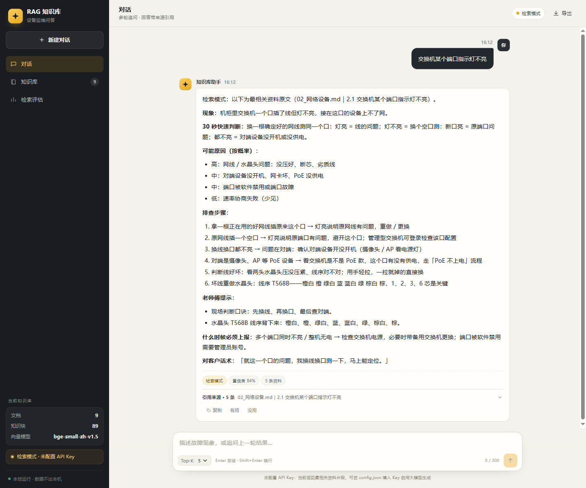
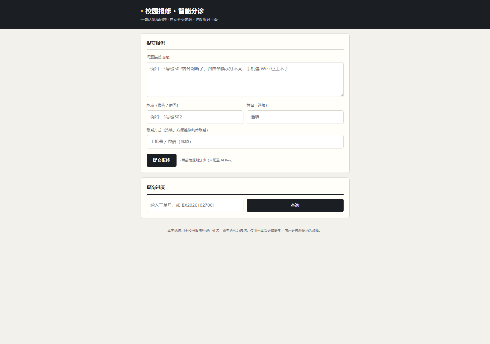
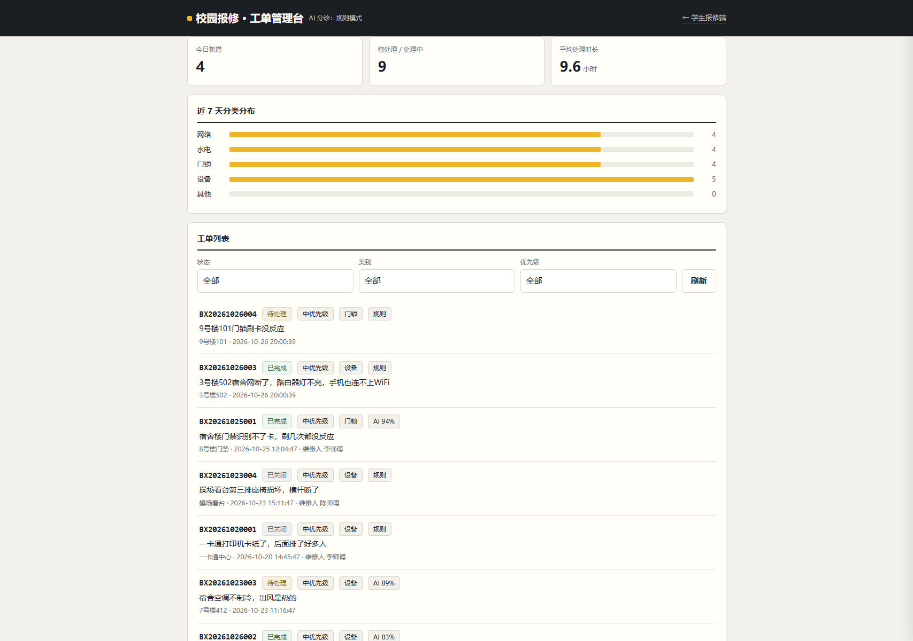

# AI Application Projects

三个可运行的 AI 应用项目：设备运维知识库 RAG 问答、校园报修 AI 分诊、网络排障助手。

| 项目 | 类型 | 核心技术 | 关键指标 |
|---|---|---|---|
| [RAG 知识库问答](rag-knowledge-base/) | 检索增强生成 | BGE 中文向量 + Chroma + LLM | 34 题测试集 **Recall@5 0.809 / Hit@5 0.853 / MRR 0.734** |
| [校园报修 AI 分诊](campus-repair-ai/) | 完整业务系统 | Flask + SQLite + LLM 分诊 + 规则降级 | 接口回归 **43 项** / 元审计 **29 项** |
| [网络排障助手](network-troubleshooting-assistant/) | 离线工具 | 单文件 HTML | 5 大类 **23 个场景 / 141 步**排查 |

---

## 1. 设备运维知识库 RAG 问答系统



**做什么**：把设备手册与排障文档构建成知识库，用户提问时先做向量检索，再让大模型基于检索资料生成回答，每条回答附带来源章节与相似度。

**核心能力**
- 三视图工作台：对话 / 知识库 / 检索评估，桌面与移动端自适应；回答 Markdown 渲染、来源卡片可展开、支持复制与导出记录
- 多供应商模型配置：自定义 Base URL / API 格式 / Key，多模型、上下文窗口、最大输出、思考等级与推理参数映射；输入框旁可切换供应商 / 模型 / 思考深度
- 知识库文档拖拽上传 / 搜索 / 删除，一键重建索引（无需命令行），变更后提示“待重建”
- 多轮对话：保留上下文，支持“那重启之后呢”这类指代追问（自动拼接上一轮问题检索）
- 防幻觉：提示词只允许依据检索资料、强制 JSON 输出校验、模型不可用或输出异常时降级为检索模式
- 评估体系：34 题测试集，Recall@K / Hit@K / MRR；对未命中案例做归因分析
- 独立体检：28 项接口/边界/安全/并发/性能检查（`审计/rag_health_check.py`）

**技术栈**：Python · Flask · Chroma · Sentence-Transformers（BAAI/bge-small-zh-v1.5）· 原生 HTML/CSS/JS

**运行**
```bash
cd rag-knowledge-base
pip install chromadb sentence-transformers flask openai
python tools/build_index.py
python app.py          # http://127.0.0.1:8100/
```

**桌面版（双击即用，无需安装 Python）**：[Releases v1.3](https://github.com/hosaile/ai-application-projects/releases/tag/v1.3) 下载 302MB zip → 解压 → 双击 `RAG知识库系统.exe`。内置向量模型与预建索引；不填 API Key 为检索模式，填 Key 为大模型模式。

更多说明见 [rag-knowledge-base/README.md](rag-knowledge-base/README.md)，体检报告见 [审计/体检报告](rag-knowledge-base/审计/体检报告_20261102.md)。

---

## 2. 校园报修 AI 分诊系统




**做什么**：学生一句话报修 → AI 分诊（类别 / 优先级 / 自查步骤 / 置信度）→ 生成工单 → 管理员流转处理 → 统计看板。

**核心能力**
- 分诊失败自动降级：超时 / 输出不合规 / 认证失败 → 立即回退关键词规则引擎，功能不中断
- 逐单记录 token 用量与耗时，成本可追溯
- 置信度低于 0.75 标记“待确认”，管理员可人工改类别（留痕）
- 重复报修检测、工单状态流转、统计看板
- 可打包为 Windows 桌面软件（PyInstaller，双窗口）

**技术栈**：Python · Flask · SQLite · 原生 HTML/CSS/JS · OpenAI / Anthropic 兼容 API

**运行**
```bash
cd campus-repair-ai
pip install flask openai requests
python seed.py
python app.py          # http://127.0.0.1:8000/
```

更多说明见 [campus-repair-ai/README.md](campus-repair-ai/README.md)。

---

## 3. 网络排障助手

**做什么**：面向弱电与网络设备的排障知识库工具，输入现象即输出分步排查步骤；单文件 HTML，手机端离线可用。

**特点**
- 5 大类 23 个故障场景、141 步排查，统一「现象 → 判断 → 原因 → 步骤 → 上报」结构
- 搜索即出步骤、可勾选、一键复制；零依赖、离线运行
- 配套 AI 对话版提示词，可粘贴到任意大模型对话中使用

**使用**：直接用浏览器打开 `网络排障助手.html`。

更多说明见 [network-troubleshooting-assistant/README.md](network-troubleshooting-assistant/README.md)。

---

## 仓库结构

```
ai-application-projects/
├── rag-knowledge-base/          # RAG 问答（源码、知识库、评估、体检）
├── campus-repair-ai/            # 校园报修系统（源码、测试、文档）
└── network-troubleshooting-assistant/  # 排障助手（单文件 + 说明）
```

## 技术亮点

1. **评估驱动**：RAG 项目不是“能跑就行”——34 题测试集量化检索质量，并记录一次失败的调参实验（2-gram 加权导致 Recall@1 下降）作为对比分析。
2. **防幻觉设计**：提示词约束 + 结构化输出校验 + 覆盖判断/降级，三层保证回答可核对。
3. **工程可靠性**：报修系统做了 43 项接口回归与 29 项元审计（统计口径独立复算、并发、注入、时间窗口、重启持久化）。
4. **交付形态多样**：桌面 exe、Web 服务、离线单文件 HTML。

## 说明

- 所有演示数据均为虚构，不含真实用户信息。
- 仓库内不含任何 API Key、账号凭据或个人联系方式；配置模板见各项目的 `config.example.json`。
