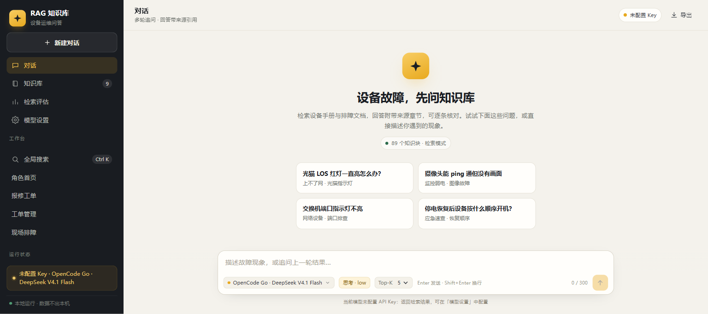
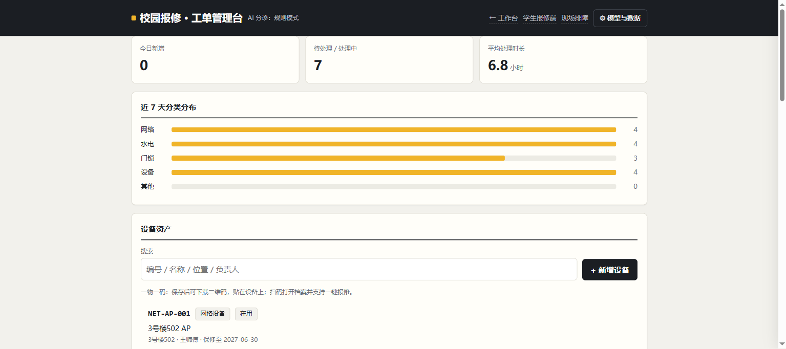
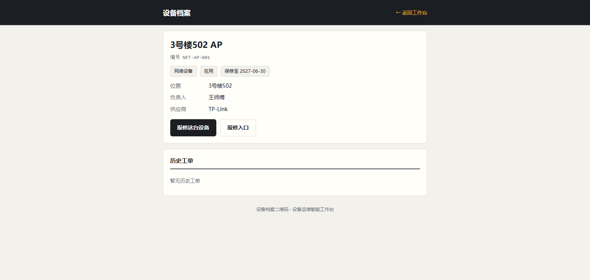
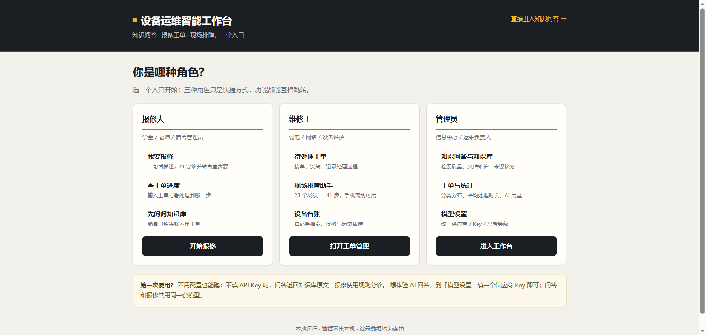
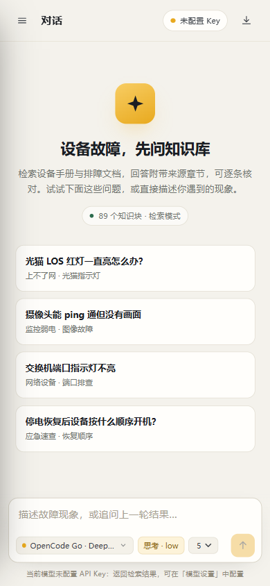
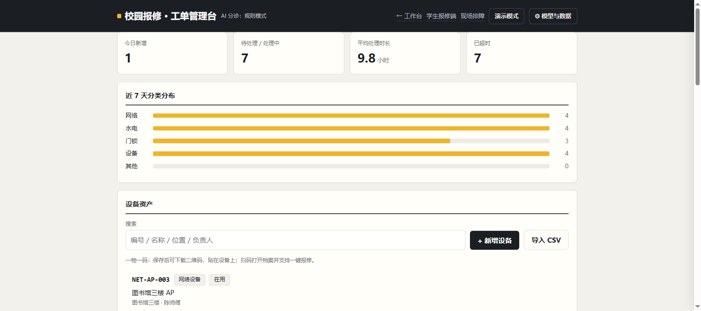
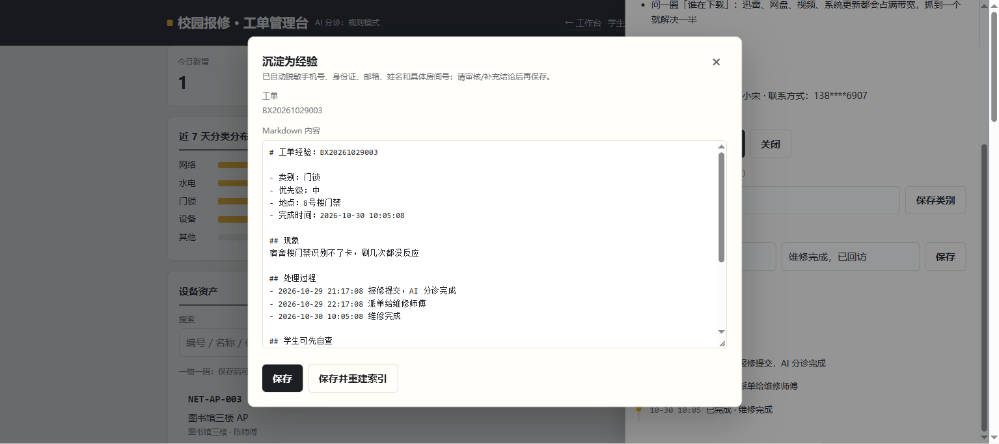
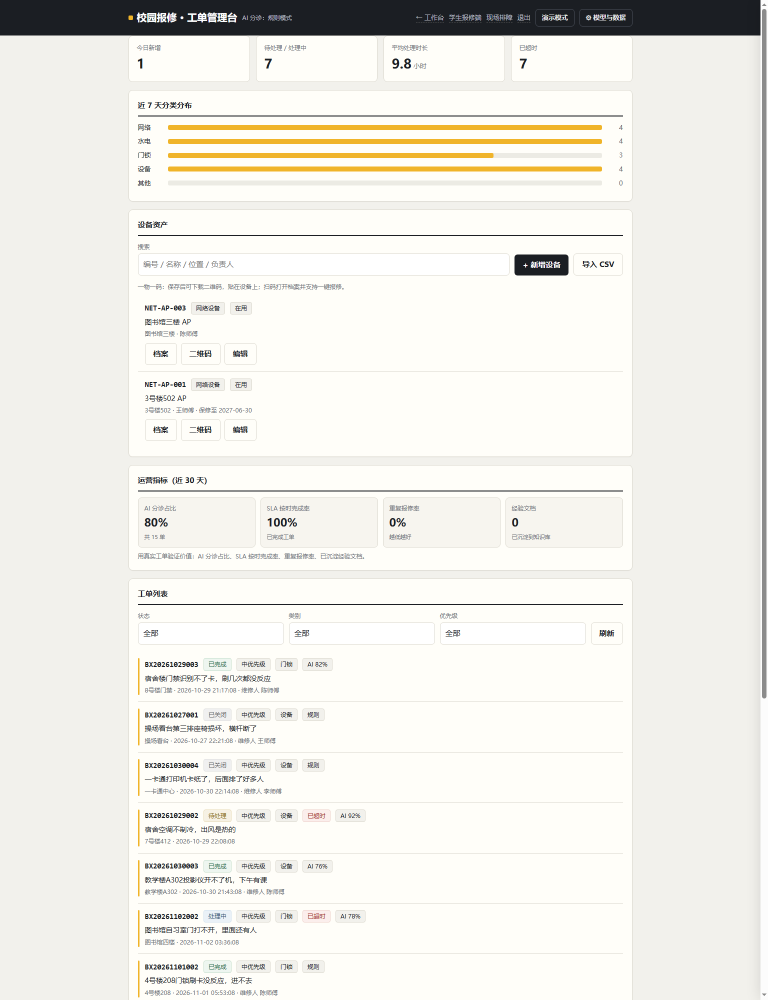
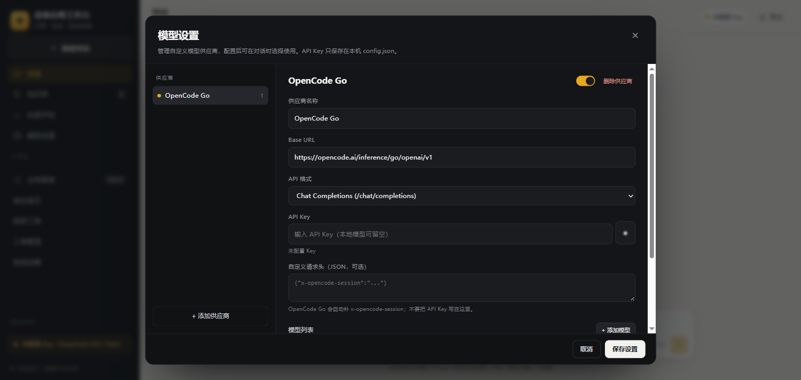
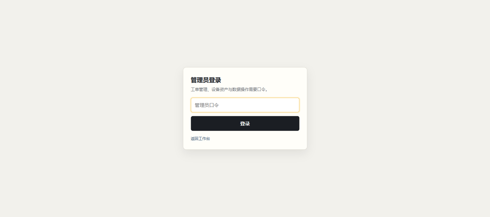

# 设备运维智能工作台

把「知识问答」「报修工单」「现场排障」合并成一个本地 Web 应用：一个进程、一个端口、一套模型配置。

- **知识问答**：设备手册/排障文档 → 向量检索 → 大模型回答，带来源章节与相似度；不填 Key 返回知识库原文。
- **报修工单**：一句话报修 → RAG 检索 + AI 分诊（类别/优先级/自查步骤/来源）→ 工单流转 → 统计；AI 不可用时规则兜底。
- **现场排障**：原单文件助手（5 类 23 场景 141 步），统一版用包装页嵌入，离线文件仍可单独打开。
- **设备资产**：一物一码，扫码看档案、保修、历史工单，并一键带设备报修。
- **资产感知问答**：问题里出现设备编号/名称/位置时，自动把设备档案与历史工单作为高优先资料，回答可核对“这台设备修过什么”。
- **运营指标**：AI 分诊占比、SLA 按时完成率、重复报修率、经验文档数，用真实工单验证价值。
- **SLA 时限**：按优先级计算处理时限（高 4h / 中 24h / 低 72h），列表标超时，统计有“已超时”。
- **工单经验沉淀**：已完成工单 → 自动生成脱敏 Markdown 草稿 → 管理员审核 → 写入 `data/docs/experience/` → 重建索引后可被问答/分诊检索。
- **管理员口令（可选）**：设置环境变量 `WORKBENCH_ADMIN_PASSWORD` 后，管理端和写操作需要登录；不设置则维持本机免登录。
- **上手辅助**：角色首页、Ctrl+K 全局搜索、示例数据、演示模式。




| 报修管理 + 设备资产 | 设备扫码档案 |
|---|---|
|  |  |

| 角色首页 | 移动端 |
|---|---|
|  |  |

## 快速开始

```bash
cd device-ops-workbench
pip install -r requirements.txt
python tools/build_index.py   # 首次：构建 89 块索引（会加载/下载 BGE 模型）
python app.py                 # http://127.0.0.1:8100/
```

源码包含 9 篇知识文档；BGE 模型（约 92MB）与向量索引未随 Git 仓库提交。`build_index.py`
会从 HuggingFace/镜像下载模型，或从 Release zip 里复制 `models/` 与 `data/chroma/` 到项目根。
桌面版 zip 已内置模型与预建索引，首次启动无需联网。

| 入口 | 地址 | 说明 |
|---|---|---|
| 知识问答 | `/` | 对话 / 知识库 / 检索评估 / 模型设置 |
| 角色首页 | `/start` | 报修人 / 维修工 / 管理员三种快捷入口 |
| 报修学生端 | `/repair/` | 提交报修、查进度、相似工单 |
| 工单管理端 | `/repair/admin` | 工单流转、统计、设备资产、演示模式 |
| 现场排障 | `/field/` | 包装页 + 原离线助手 |
| 设备扫码页 | `/a/<设备编号>` | 手机扫码打开设备档案 |
| 全局搜索 | `Ctrl+K` | 搜知识、工单、设备、操作 |


| SLA 统计与超时标记 | 工单经验沉淀 |
|---|---|
|  |  |



## 桌面版（已打包验证）

打包产物：`dist/设备运维工作台/设备运维工作台.exe`（804MB），压缩包 `dist/设备运维工作台-v2.0.zip`（302MB）。
GitHub Release v2.0 资产：`DeviceOpsWorkbench-v2.0.zip`（与本地 zip 同一 SHA256）。
已在干净目录实测：首次启动自动生成 `data/` 与 `config.json`，问答、报修、现场排障、二维码、经验沉淀均可用。

- 双击 `设备运维工作台.exe`：启动本地服务并打开应用窗口，目标电脑无需安装 Python。
- 首次运行在 exe 同级生成 `data/`（文档/索引/工单）和 `config.json`；不填 Key 为检索/规则模式。
- 桌面版随机端口，关闭窗口后服务仍在后台；可在任务管理器结束 `设备运维工作台.exe`。

源码版入口为 `desktop_workbench.py`：启动本地服务后自动打开窗口，数据/配置放 exe 同级。
打包命令（需先装 CPU 版 torch）：

```bash
python -m venv .venv_build
.venv_build\Scripts\pip install torch==2.6.0 transformers sentence-transformers chromadb flask openai qrcode pyinstaller
.venv_build\Scripts\pyinstaller --noconfirm --onedir --windowed --name "设备运维工作台" ^
  --hidden-import encodings.idna --collect-all chromadb ^
  --add-data "modules/qa/static;modules/qa/static" ^
  --add-data "modules/repair/static;modules/repair/static" ^
  --add-data "modules/repair/kb_snippet.json;modules/repair" ^
  --add-data "modules/field/网络排障助手.html;modules/field" ^
  --add-data "data/docs;data/docs" ^
  --add-data "data/chroma;data/chroma" ^
  --add-data "data/tests;data/tests" ^
  --add-data "models;models" ^
  --add-data "config.example.json;." desktop_workbench.py
```



## 桌面版校验信息

- 压缩包：`dist/设备运维工作台-v2.0.zip`，316,346,119 字节（约 302MB）
- SHA256：`1c86ed15fc72186a8c24173cadf89e617940f99f04c8ee6e2f3c8c0afcc9ea62`
- 包内无 `config.json`、`data/tickets.db`、`desktop.log`；`config.example.json` 所有 Key 为空。

## 统一模型配置

只有一套供应商/模型/Key，问答与报修共用。默认且当前只保留一个模型：

```json
{
  "providers": [{
    "id": "opencode-go",
    "name": "OpenCode Go",
    "base_url": "https://opencode.ai/inference/go/openai/v1",
    "api_format": "openai",
    "models": [{
      "id": "deepseek-v4.1-flash",
      "model_id": "deepseek-v4.1-flash",
      "name": "DeepSeek V4.1 Flash"
    }]
  }],
  "active": {"provider_id": "opencode-go", "model_id": "deepseek-v4.1-flash", "reasoning": "low"}
}
```

- 在页面「模型设置」里填 Key，保存即生效；Key 只写入本机 `config.json`（已在 `.gitignore` 中）。
- 接口只返回 `has_key`，不返回 Key 明文。
- 不填 Key：问答返回检索原文，报修使用规则分诊；功能不中断。
- 需要换模型时在「模型设置 → 添加模型」里加，测试阶段统一使用 `deepseek-v4.1-flash`。

## 管理员口令（可选）

默认本机免登录。需要局域网访问或演示权限控制时：

```bash
# Windows PowerShell
$env:WORKBENCH_ADMIN_PASSWORD="your-password"
python app.py
```



设置后：`/repair/admin` 跳转登录页；工单写操作、设备写操作、数据管理、经验沉淀需要登录；
学生报修、工单查询、扫码档案仍可直接访问。口令只从环境变量读取，不写入 `config.json`。

## 硬件接入（可选，默认关闭）

当前版本已实现遥测上报接口（模拟数据验证），真实硬件尚未接入。

```bash
# Windows PowerShell
$env:WORKBENCH_INGEST_TOKEN="your-ingest-token"
# config.json 里设置 "hardware": {"enabled": true, ...}
python app.py
```

```http
POST /repair/api/telemetry
X-Ingest-Token: your-ingest-token
Content-Type: application/json

{
  "asset_code": "NET-AP-001",
  "ts": "2027-03-01T10:00:00+08:00",
  "msg_id": "esp32-001-000123",
  "metrics": {"temperature": 42.5, "current": 1.2, "door": 0},
  "units": {"temperature": "C", "current": "A"}
}
```

- 资产页显示最新遥测/在线状态；管理端显示设备告警。
- 高温/漏水等高危告警自动建单；中危告警只记录，需人工确认。
- 同一设备同一规则 10 分钟内不重复告警，消息按 `msg_id` 幂等。
- 硬件采购与接线见 `docs/hardware.md`（如有）。

## 数据目录

```
device-ops-workbench/
├── data/
│   ├── docs/             # 知识库文档（9 篇）
│   ├── chroma/           # 向量索引（kb_v1）
│   ├── tests/            # 评估集与结果
│   ├── feedback.jsonl    # 问答反馈
│   ├── tickets.db        # 报修工单（自动生成）
│   └── demo/             # 演示模式独立数据库
├── models/               # BGE 中文向量模型
├── modules/qa|repair|field
├── core/                 # paths / config / llm / logging
└── tests/                # 统一回归测试 + mock 模型
```

## 测试

```bash
python tests/test_workbench.py       # 103 项：主流程
python tests/test_admin_auth.py      # 11 项：管理员口令
```

覆盖 103 项：三入口、统一配置与 Key 脱敏、RAG 问答、资产感知检索、AI 分诊 + 来源、规则兜底、工单流转、
SLA 时限、工单经验沉淀与索引重建、运营指标、相似工单、资产/二维码/关联、演示模式、全局搜索、数据备份、边界与安全。
另有 11 项管理员口令测试。

测试使用本地 mock 模型（模型 ID 仍为 `deepseek-v4.1-flash`），不依赖外部网络和真实 Key。
真实模型连通性在页面「模型设置 → 连接测试」验证。

## 与三个独立项目的关系

- 原 `毕设_RAG知识库系统`、`campus-repair-ai`、`network-troubleshooting-assistant` 保持不动，作为模块原型。
- 本仓库是合并后的统一工作台；论文指标仍以独立 RAG 项目为准。
- 现场排障原单文件不做修改，统一版只增加入口包装。

## 说明

- 演示数据均为虚构，不含真实姓名、电话、房间号。
- 默认仅监听 `127.0.0.1`；局域网手机访问需显式 `HOST=0.0.0.0 python app.py`。
- 报修管理端暂未加登录，仅适合本机/内网演示；管理员口令在后续阶段加入。
