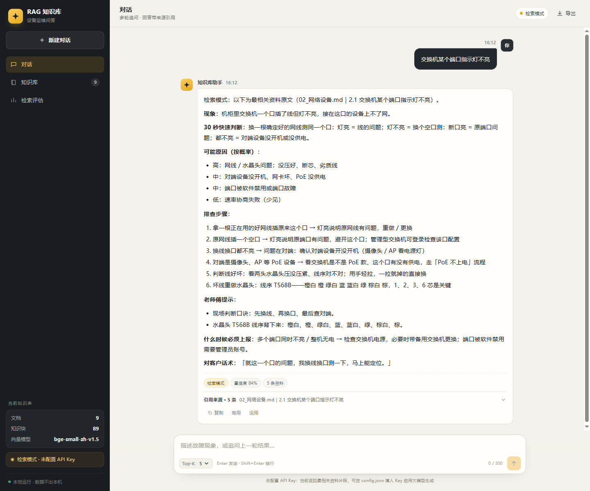
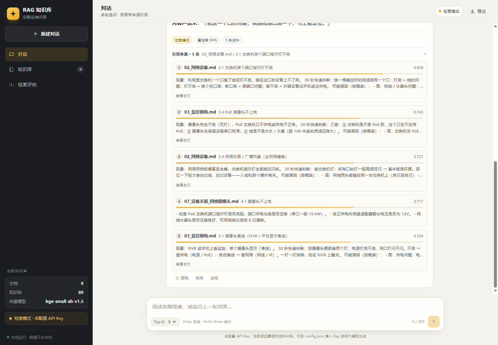
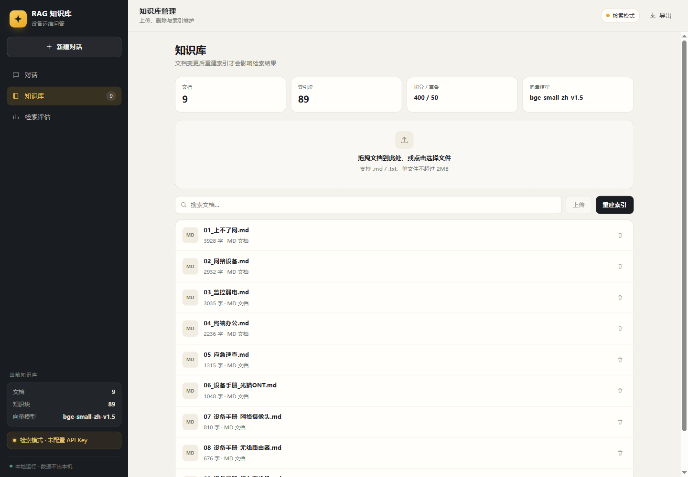
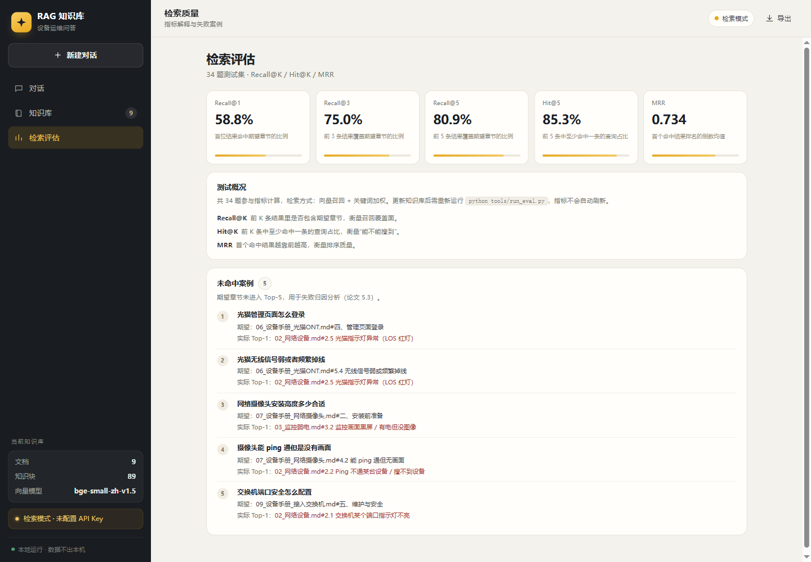
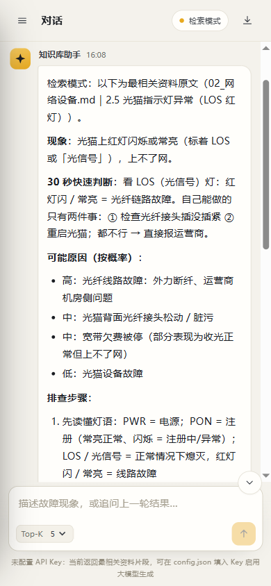

# RAG 知识库问答系统（毕业设计）

基于大语言模型 + 向量检索的设备运维知识库问答系统。提问 → 检索知识库 → 大模型生成带来源引用的回答，支持多轮对话、知识库文档动态上传与防幻觉降级。

界面为三视图工作台（对话 / 知识库 / 检索评估），桌面与移动端自适应。

## 界面









移动端：



界面特性：

- **对话**：Markdown 渲染、检索加载态、来源卡片（文档 / 章节 / 相似度 / 原文）、复制回答、有用/没用反馈、导出 Markdown
- **知识库**：拖拽上传、文档搜索、删除二次确认、待重建提示、重建进度与耗时
- **评估**：Recall@1/3/5、Hit@5、MRR 指标卡，以及未命中案例列表（失败归因）

## 快速开始

```bash
cd rag-knowledge-base

# 1) 依赖（已安装可跳过）
pip install chromadb sentence-transformers flask openai

# 2) 建立向量索引（首次或文档变更后；也可在页面点「重建索引」）
python tools/build_index.py

# 3) 运行检索评估
python tools/run_eval.py

# 4) 启动问答服务
python app.py            # 默认 http://127.0.0.1:8100/（仅本机）
HOST=0.0.0.0 python app.py   # 需要局域网手机访问时
```

Windows 下若出现 Keras/Transformers 冲突，设置 `USE_TF=0`（代码内已默认设置）。

## 桌面版（双击即用，推荐演示）

打包产物：`dist/RAG知识库系统/RAG知识库系统.exe`（完整包约 790MB，压缩后约 302MB）

- **双击启动**：自动启动本地服务并打开应用窗口（内置向量模型与预建索引，**目标电脑无需安装 Python**）
- 首次运行在 exe 同级生成 `data/`（知识库文档与索引）和 `config.json`
- 填 API Key：编辑 exe 同级的 `config.json` → `llm.api_key`，重启生效；不填为检索模式
- 关闭窗口后服务仍在后台，可在任务管理器结束 `RAG知识库系统.exe`

重新打包（需先建 venv 安装 CPU 版 torch）：

```bash
python -m venv .venv_build
.venv_build\Scripts\pip install torch==2.6.0 transformers sentence-transformers chromadb flask openai pyinstaller
.venv_build\Scripts\pyinstaller --noconfirm --onedir --windowed --name "RAG知识库系统" ^
  --hidden-import encodings.idna --collect-all chromadb ^
  --add-data "static;static" --add-data "models;models" ^
  --add-data "data/docs;data/docs" --add-data "data/chroma;data/chroma" ^
  --add-data "data/tests;data/tests" ^
  --add-data "config.example.json;." desktop_rag.py
```

## 配置

`config.json`：

```json
{
  "embedding_model": "BAAI/bge-small-zh-v1.5",
  "chunk_size": 400,
  "chunk_overlap": 50,
  "top_k": 5,
  "docs_dir": "data/docs",
  "chroma_dir": "data/chroma",
  "llm": {"base_url": "https://api.deepseek.com", "model": "deepseek-flash",
          "api_key": "", "temperature": 0.2, "max_tokens": 800, "timeout": 30}
}
```

- `llm.api_key` 为空时运行在**检索模式**（返回最相关资料原文，可离线演示）
- 填入 Key 后为**大模型生成模式**（答案 + 来源 + token 用量）

## 目录结构

```
rag-knowledge-base/
├── app.py                # Flask 服务（/api/ask、/api/stats、/api/eval、/api/feedback）
├── desktop_rag.py        # 桌面启动器（PyInstaller 入口）
├── config.example.json   # 配置模板（不含 Key）
├── rag/
│   ├── ingest.py         # 文档加载 + 按标题分节 + 窗口切分
│   ├── embed.py          # bge 中文向量化
│   ├── store.py          # Chroma 索引（重建/检索/统计/章节全文）
│   ├── retrieve.py       # 召回 + 章节去重 + 关键词加权
│   ├── generate.py       # 提示词 + LLM 调用 + JSON 校验 + 降级
│   └── evaluate.py       # Recall@K / Hit@K / MRR
├── data/
│   ├── docs/             # 9 篇知识库文档
│   ├── chroma/           # 向量索引（自动生成）
│   └── tests/            # 34 题评估集与结果
├── static/index.html     # 三视图工作台（对话 / 知识库 / 检索评估）
├── screenshots/          # 界面截图
├── tools/build_index.py  # 建索引
├── tools/run_eval.py     # 跑评估
└── 审计/                 # 独立体检脚本与报告
```

## 当前指标（34 题测试集）

| 指标 | K=1 | K=3 | K=5 |
|---|---|---|---|
| Recall@K | 0.588 | 0.750 | 0.809 |
| Hit@K | 0.647 | 0.794 | 0.853 |
| MRR | 0.734 | — | — |

索引：9 篇文档 → 89 块（chunk 400 / overlap 50）。

## 常用命令

```bash
python tools/build_index.py     # 重建索引
python tools/run_eval.py        # 评估（--hybrid 0 可测纯向量）
PORT=8100 python app.py         # 指定端口启动
curl -X POST localhost:8100/api/ask -d '{"question":"光猫LOS红灯","top_k":5}' -H "Content-Type: application/json"
```

## 说明

- 知识库内容来自个人整理的排障资料与设备手册（演示用，实际设备以厂商文档为准）。
- 回答均附来源章节与相似度，便于核对；模型不可用时自动降级为检索模式。
